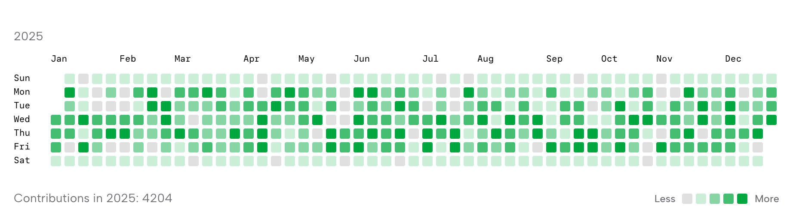
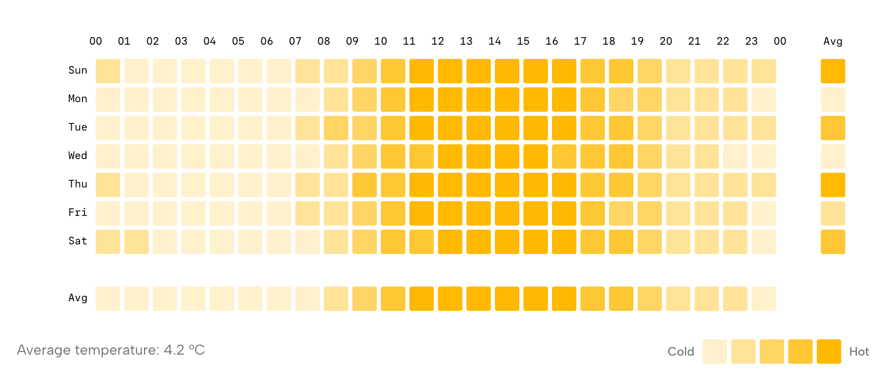
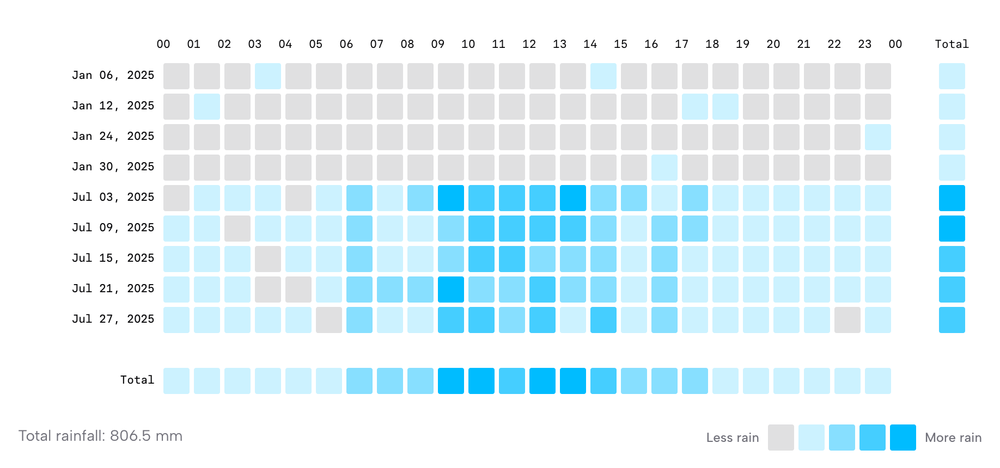
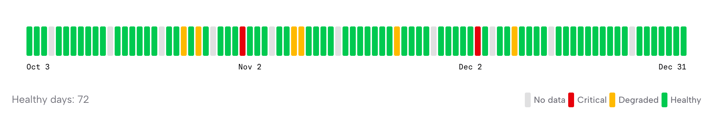

<div align="center">

# shadcn-heatmap

**Live demo: [https://heatmap.chingru.com](https://heatmap.chingru.com)**

Heatmap components for React, built for [shadcn/ui](https://ui.shadcn.com).

Built on SVG and Tailwind v4 tokens. Copy the source, own it entirely.

</div>

---

## Components

Each component is a single file. Install it in a React 19 project with Tailwind CSS v4.

### CalendarHeatmap

GitHub-style yearly contribution grid. Supports multiple years, ISO Monday start, custom colors, i18n labels, and full tooltip control.



### WeekdayHeatmap

Weekday × hour-of-day matrix for recurring weekly patterns. Supports optional aggregate rows and columns with custom compute functions, i18n, and custom colors.



### DateHeatmap

Date × hour grid for zoomed time windows (1 to 4 weeks). Supports optional aggregate rows and columns with custom compute functions, i18n, and custom colors.



### StatusHeatmap

Daily status timeline for uptime or incident history. Four built-in statuses (healthy, degraded, critical, and no data), with support for custom values, custom colors, i18n, and adjustable label intervals.



## Requirements

- React 19+
- Tailwind CSS v4
- shadcn/ui project setup

## Installation

See the [installation guide](https://heatmap.chingru.com/install) for a step-by-step walkthrough.

### shadcn CLI (recommended)

1. **Install via `shadcn@latest`.** Pick the component you need: the CLI writes it into your configured components directory, for example `src/components/heatmap/`.

   ```bash
   # CalendarHeatmap
   npx shadcn@latest add @heatmap/calendar-heatmap

   # WeekdayHeatmap
   npx shadcn@latest add @heatmap/weekday-heatmap

   # DateHeatmap
   npx shadcn@latest add @heatmap/date-heatmap

   # StatusHeatmap
   npx shadcn@latest add @heatmap/status-heatmap
   ```

   `@heatmap` is an official [shadcn registry namespace](https://ui.shadcn.com/docs/registry/namespace), listed in the [shadcn directory](https://github.com/shadcn-ui/ui/pull/10803). Alternatively, install from the full URL: `npx shadcn@latest add https://heatmap.chingru.com/r/calendar-heatmap.json`, or straight from this GitHub repo: `npx shadcn@latest add rutopio/shadcn-heatmap/calendar-heatmap`.

2. **Ensure the runtime dependencies exist.** The components only need these: the CLI installs them automatically, listed here for reference.

   ```bash
   pnpm add date-fns clsx tailwind-merge
   ```

3. **(Optional) Add a tooltip for hover details.** The components render fine without it; the demos wrap blocks in a tooltip to show activity details on hover. Use any tooltip you like, or the shadcn one:

   ```bash
   npx shadcn@latest add tooltip
   ```

### Manual

1. **Install peer dependencies.**

   ```bash
   pnpm add date-fns clsx tailwind-merge
   ```

2. **Add the `cn` helper** (if not already present). Create `src/lib/utils.ts`:

   ```ts
   import { clsx, type ClassValue } from "clsx";
   import { twMerge } from "tailwind-merge";

   export function cn(...inputs: ClassValue[]) {
     return twMerge(clsx(inputs));
   }
   ```

3. **Expose theme tokens used by the blocks.** The heatmaps reference `--color-chart-1` for activity colors, `--color-secondary` for empty cells, and `--color-muted-foreground` for labels. Use the `colors` prop for block colors and `labelClassName` for axis text.

   ```css
   /* src/styles/globals.css (Tailwind v4) */
   @import "tailwindcss";

   @theme {
     --color-secondary: oklch(96.7% 0.001 286.4);
     --color-chart-1: oklch(64.6% 0.222 41.1);
     --color-muted-foreground: oklch(55.2% 0.014 285.9);
   }
   ```

4. **(Optional) Add a tooltip for hover details.** The components render fine without it; the demos wrap blocks in a tooltip to show activity details on hover.

   ```bash
   npx shadcn@latest add tooltip
   ```

5. **Copy the component you need** from [`src/components/heatmap/`](https://github.com/rutopio/shadcn-heatmap/tree/master/src/components/heatmap) on GitHub and place it under `src/components/heatmap/` in your project.

## Usage

The heatmaps use client-side React APIs. In Next.js or another React Server Components app, put the composition below in a file beginning with `"use client"`, including any render callbacks. Plain data can be passed in from a server component.

For the Base UI tooltip examples, initialize a Base UI shadcn project or install `@base-ui/react` before adding `tooltip`. Tooltip examples on the demo site use the Base UI version of shadcn Tooltip (`render` and `delay`). If your project uses the Radix version, adapt those two tooltip props to its API.

### Data rules

- Dates must be valid `YYYY-MM-DD` strings. They represent local calendar dates, without a time zone.
- Hours are integers from 0 to 23. Weekdays are integers from 0 (Sunday) to 6 (Saturday).
- Values must be finite numbers. Duplicate dates or time slots use the last input record for cells, statistics, and aggregates.
- CalendarHeatmap and StatusHeatmap fill dates between the first and last records. Missing cells have value 0. DateHeatmap and WeekdayHeatmap fill missing hours with value 0.
- Invalid dates, hours, weekdays, values, level counts, or aggregate lengths throw a `RangeError`.
- `levels` must be an integer of at least 2, or at least 1 with `isNormalized`. Normalization uses the actual minimum and maximum, including negative and fractional values. A constant dataset uses the first colored level.
- Aggregate row callbacks must return 24 finite values. Column callbacks return 7 values for WeekdayHeatmap or one per date for DateHeatmap. The body sets `activity.extra` so the default block renderer positions these cells correctly.
- Aggregates do not change the footer calculation. Use the Stat component's `compute` or `children` prop to show an average, median, or other metric.


### CalendarHeatmap

```tsx
"use client";

import {
  CalendarHeatmap,
  CalendarHeatmapBlock,
  CalendarHeatmapBody,
  CalendarHeatmapFooter,
  CalendarHeatmapLegend,
  CalendarHeatmapStat,
} from "@/components/heatmap/calendar-heatmap";

const data = [
  { date: "2024-01-01", value: 3 },
  { date: "2024-01-02", value: 7 },
  // ...
];

export default function Example() {
  return (
    <CalendarHeatmap data={data} weekStart={1}>
      <CalendarHeatmapBody>
        {({ activity, dayIndex, weekIndex }) => (
          <CalendarHeatmapBlock
            activity={activity}
            dayIndex={dayIndex}
            weekIndex={weekIndex}
          />
        )}
      </CalendarHeatmapBody>
      <CalendarHeatmapFooter>
        <CalendarHeatmapStat />
        <CalendarHeatmapLegend />
      </CalendarHeatmapFooter>
    </CalendarHeatmap>
  );
}
```

### WeekdayHeatmap

```tsx
"use client";

import {
  WeekdayHeatmap,
  WeekdayHeatmapBlock,
  WeekdayHeatmapBody,
  WeekdayHeatmapFooter,
  WeekdayHeatmapLegend,
  WeekdayHeatmapStat,
} from "@/components/heatmap/weekday-heatmap";

// weekday: 0 to 6 (Sunday to Saturday)
// hour:    0 to 23
const data = [
  { weekday: 1, hour: 9, value: 16.3 },
  { weekday: 1, hour: 14, value: 22.1 },
  // ...
];

// Optional: aggregated row/column pass through `extraRow` / `extraColumn`.
// `compute` receives the full data; return 24 values for the row (by hour)
// or 7 values for the column (indexed by weekday 0 to 6).
const avgByHour = (d: typeof data) => {
  const sums = Array(24).fill(0);
  const counts = Array(24).fill(0);
  d.forEach((a) => {
    sums[a.hour] += a.value;
    counts[a.hour] += 1;
  });
  return sums.map((s, i) => (counts[i] ? s / counts[i] : 0));
};

export default function Example() {
  return (
    <WeekdayHeatmap
      data={data}
      isNormalized
      extraRow={{ label: "Avg", compute: avgByHour }}
    >
      <WeekdayHeatmapBody>
        {({ activity }) => <WeekdayHeatmapBlock activity={activity} />}
      </WeekdayHeatmapBody>
      <WeekdayHeatmapFooter>
        <WeekdayHeatmapStat />
        <WeekdayHeatmapLegend />
      </WeekdayHeatmapFooter>
    </WeekdayHeatmap>
  );
}
```

### DateHeatmap

```tsx
"use client";

import {
  DateHeatmap,
  DateHeatmapBlock,
  DateHeatmapBody,
  DateHeatmapFooter,
  DateHeatmapLegend,
  DateHeatmapStat,
} from "@/components/heatmap/date-heatmap";

// date: YYYY-MM-DD
// hour: 0 to 23
const data = [
  { date: "2025-12-11", hour: 13, value: 8.4 },
  { date: "2025-12-11", hour: 14, value: 22.7 },
  // ...
];

// Optional: aggregated row / column via `extraRow` / `extraColumn`.
// Row `compute` returns 24 values (one per hour). Column `compute`
// receives `(data, dates)` and returns one value per date.
const sumByHour = (d: typeof data) => {
  const out = Array(24).fill(0);
  d.forEach((a) => {
    out[a.hour] += a.value;
  });
  return out;
};
const sumByDate = (d: typeof data, dates: string[]) =>
  dates.map((date) =>
    d.filter((a) => a.date === date).reduce((s, a) => s + a.value, 0),
  );

export default function Example() {
  return (
    <DateHeatmap
      data={data}
      extraRow={{ label: "Total", compute: sumByHour }}
      extraColumn={{ label: "Total", compute: sumByDate }}
    >
      <DateHeatmapBody>
        {({ activity, dateIndex }) => (
          <DateHeatmapBlock activity={activity} dateIndex={dateIndex} />
        )}
      </DateHeatmapBody>
      <DateHeatmapFooter>
        <DateHeatmapStat />
        <DateHeatmapLegend />
      </DateHeatmapFooter>
    </DateHeatmap>
  );
}
```

### StatusHeatmap

```tsx
"use client";

import {
  StatusHeatmap,
  StatusHeatmapBlock,
  StatusHeatmapBody,
  StatusHeatmapFooter,
  StatusHeatmapLegend,
  StatusHeatmapStat,
} from "@/components/heatmap/status-heatmap";

// value: 0 = no data, 1 = critical, 2 = degraded, 3 = healthy
const data = [
  { date: "2025-01-01", value: 3 },
  { date: "2025-01-02", value: 2 },
  { date: "2025-01-03", value: 1 },
];

export default function Example() {
  return (
    <StatusHeatmap data={data}>
      <StatusHeatmapBody>
        {({ activity, dayIndex }) => (
          <StatusHeatmapBlock activity={activity} dayIndex={dayIndex} />
        )}
      </StatusHeatmapBody>
      <StatusHeatmapFooter>
        <StatusHeatmapStat />
        <StatusHeatmapLegend />
      </StatusHeatmapFooter>
    </StatusHeatmap>
  );
}
```

See the [live demo](https://heatmap.chingru.com) for full examples of all four components, including tooltips, i18n, and custom colors.

## Contributing

Open an [issue](https://github.com/rutopio/shadcn-heatmap/issues) or pull request for bugs, new variants, accessibility improvements, or documentation fixes.

If you're adding a new component or changing the public API, please open an issue first so we can align on scope before you write the code.

### Local setup

Use Node 24 and pnpm 11.8.0, as specified in `.nvmrc` and `package.json`.

```bash
pnpm install
pnpm dev            # start the demo site on http://localhost:5173
```

### Commits and branches

- Branch from `master` using a short descriptive name (`fix/status-empty-data`, `feat/binary-heatmap`).
- Keep commits focused; prefer a series of small commits over one large one.
- Use short commit messages that describe the change.

### Before opening a PR

Run the checks used by CI:

```bash
pnpm run check      # formatting, lint, types, tests, examples, and registry consistency
pnpm run build      # build the registry + the demo site
```

For component changes, also run the browser and consumer installation checks:

```bash
pnpm exec playwright install chromium
pnpm test:browser
pnpm test:registry  # installs through shadcn in temporary projects; requires network access
```

The registry check tests full URLs and a local `@heatmap` namespace with the generated files. It installs WeekdayHeatmap first to check its dependencies, then compiles all four components in clean projects. It does not publish the registry.

Default examples live in `src/examples/`. The demo and its displayed code use these same files. Biome handles JavaScript, TypeScript, and JSON formatting and linting. Code snippets use the same `biome.json` settings. Run `pnpm format` to format code and snippets, or `pnpm fix` for automatic lint fixes.

To rebuild social images after changing the examples:

```bash
python3 -m venv .venv
.venv/bin/pip install -r scripts/requirements-og.txt
pnpm screenshots
.venv/bin/python scripts/build-og.py
```

Keep generated registry files in the same commit as their source changes. `pnpm build` updates them and generates static metadata for every documentation route.

## License

MIT for project code. See [THIRD_PARTY_NOTICES.md](THIRD_PARTY_NOTICES.md) for font licenses.
